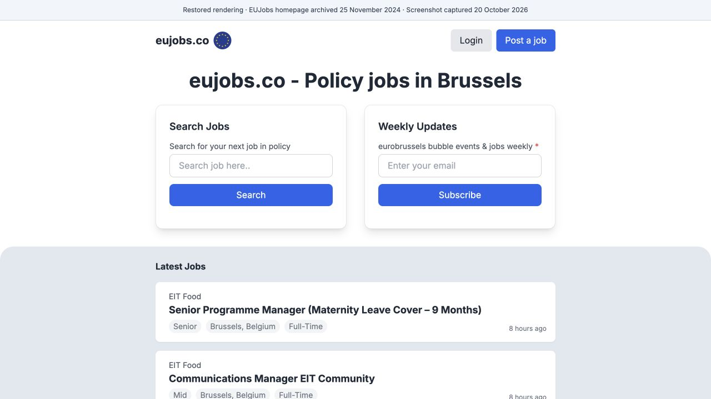

# EUJobs history and contributors

EUJobs has evolved through multiple implementations. The source in this public
repository represents the current application; the original development history
is preserved separately in a private archive.

## The homepage in November 2024

*Restored rendering of the [Wayback Machine capture from 25 November 2024](https://web.archive.org/web/20241125213411/https://www.eujobs.co/), captured in a browser on 20 October 2026.*

The archive preserves the page content and job listings, but one stylesheet is
missing. This rendering combines that archived HTML and the surviving stylesheet
with styles rebuilt from the nearest preserved source revision before the capture,
using Tailwind CSS 3.4.1. Inter font files were supplied locally; analytics,
scripts and external form actions were disabled. The disclosure strip was added
for this image. It illustrates the recovered design, rather than claiming a
pixel-exact screenshot taken in 2024. Listings and relative times belong to the
archived page and are not current vacancies.

## Original collaborators

Madan Park developed EUJobs with collaborators. We acknowledge the following
contributions to the original application:

- **[Mouise Bashir (`mouise1111`)](https://github.com/mouise1111)** contributed
  EUJobs branding, guest posting and checkout flows, job editing, form validation
  and interface improvements.
- **[Charlene (`charlenenicer`)](https://github.com/charlenenicer)** contributed
  fixes to middleware paths and Stripe publishable-key configuration.

These credits are supported by the recovered Git history. Examples include
Mouise's EUJobs branding change on 15 October 2024 and guest-payment change on
17 October 2024, and Charlene's middleware and Stripe configuration fixes on
10 October 2024. The examples do not measure either person's full contribution
or attribute the later rewritten files to them.

## Timeline

| Period | Development record |
| --- | --- |
| September 2024 onward | The recovered original application history begins on 23 September 2024 and includes the collaborators credited above. |
| October 2026 | A later rebuild and Azure releases form the current application's development history. |
| 20 October 2026 | The original 212 commits were preserved unchanged in the private development repository, with an explicit history-preservation merge. The current application files were unchanged by that merge. |
| 20 October 2026 | This public repository presents a sanitized source snapshot and case study of the current application. |

## What is preserved

The private archive retains the recovered original code, commit IDs, author and
committer metadata, messages and parent relationships. The preservation merge
records when the histories were joined; it does not assert uninterrupted Git
ancestry between the original application and the rebuild.

The public repository deliberately has a separate history. Original commit
identities, historical operational material and production data are not imported
here. Contributor credit is documented on this page without assigning old
commits to a new author.

The recovered history does not establish the exact version delivered at sale or
the extent of code reuse in the current implementation. See the
[case study](docs/CASE_STUDY.md) and
[publication provenance](docs/PROVENANCE.md) for the scope of this public release.
