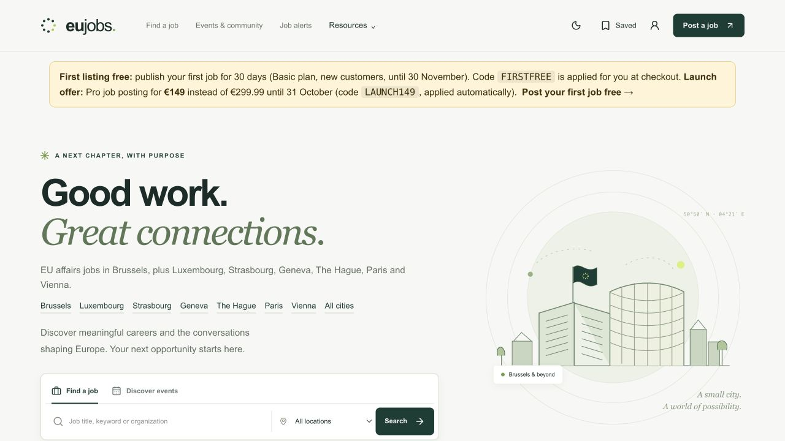

# EUJobs

**A European careers platform I built and sold.**

EUJobs brings jobs, policy events and career resources together for the European affairs community. This repository contains a case study and the complete application source, prepared from the Azure production release on **20 October 2026**.

[Visit EUJobs](https://eujobs.co) · [Read the case study](docs/CASE_STUDY.md) · [Explore the architecture](docs/ARCHITECTURE.md) · [Run locally](docs/DEVELOPMENT.md)

[](https://github.com/MadanChaollaPark/eujobs/actions/workflows/ci.yml)



## What the product does

| Audience | Experience |
| --- | --- |
| Job seekers | Search and filter roles by policy area, organization, location, contract, experience and salary; save listings and searches; receive confirmed email alerts. |
| Employers | Submit a job without an account, pay through Stripe, and manage it through a private link. Editorial review controls publication. |
| Event attendees | Discover European policy events, download individual calendars, or purchase a calendar pass for a selected month. |
| Editors | Review submissions, maintain sourced inventory, handle contacts and monitor operations through protected tools. |
| Developers | Query public jobs and events through a versioned API, OpenAPI, remote MCP, a CLI or local MCP. |

## Engineering worth exploring

- **Payment integrity:** server-controlled prices, idempotent checkout, signed webhooks and durable refund reconciliation. Payment and editorial approval are separate states.
- **Scoped access:** hashed session and recovery tokens, isolated guest owners, expiring management links and optimistic concurrency on listing edits.
- **Reliable messaging:** consent confirmation, durable outbox, deduplication and explicit handling of uncertain provider responses.
- **Useful discovery:** filters apply before pagination; unknown salary and eligibility information stays unknown; public API fields are explicitly selected.
- **Operational simplicity:** Next.js and SQLite on an Azure VM, with immutable releases, systemd services and independently verified database backups.

## Stack

Next.js 16 · React 19 · TypeScript · Node.js 24+ · SQLite · Stripe · MCP · Azure

```sh
npm ci
cp .env.example .env.local
npm run dev
```

Open [localhost:3210](http://localhost:3210). The local database starts empty. Production accounts, listings, payments, resource catalogs and credentials are not distributed. Provider integrations require your own configuration; email and Google Calendar are disabled by default.

```sh
npm run verify  # isolated fixture tests, TypeScript checks and production build
```

CI validates this repository and has no production deployment step.

## Explore the repository

| Start here | What you will find |
| --- | --- |
| [Case study](docs/CASE_STUDY.md) | Product, commercial context and engineering decisions |
| [Architecture](docs/ARCHITECTURE.md) | Components, boundaries and key request flows |
| [Source map](docs/REPOSITORY.md) | Where the implementation lives |
| [Development guide](docs/DEVELOPMENT.md) | Local setup, configuration and generic operations |
| [API, MCP and CLI guide](AGENT_ACCESS.md) | Read-only integrations and examples |
| [Behavior contract](BUILD_CONTRACT.md) | Required application invariants |
| [Publication provenance](docs/PROVENANCE.md) | Snapshot origin, sanitization and verification |

This is a source snapshot of the current implementation, not an archive of the version at the time of sale. Historical Git identities, production data and private operational records are excluded. The original private development history is preserved separately.
