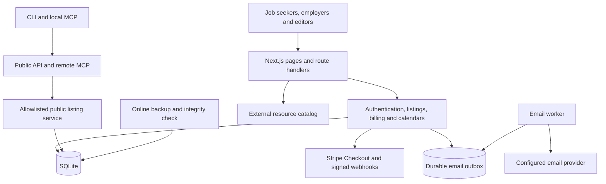
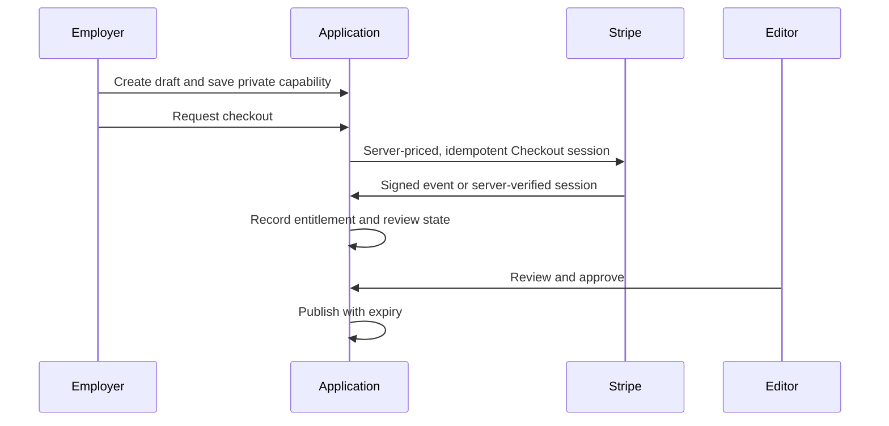

# Architecture

## Boundaries

| Boundary | Implementation |
| --- | --- |
| Browser mutations | Canonical-origin checks, bounded input, authentication or scoped guest access, rate limiting |
| Account ownership | Password hashing, hashed sessions, purpose-scoped recovery and verification |
| Paid publication | Server-side prices, verified payment entitlement, separate editorial approval, expiry |
| Guest management | Random capability in a fragment, hashed storage, restricted cookie and object scope |
| Public integrations | Explicit output schemas; private and inactive records excluded |
| Messaging | Confirmed consent, durable outbox, deduplication and suppression |
| Runtime storage | SQLite and resource catalogs outside source control |

## Employer posting

The checkout return URL alone never proves payment or grants management access. Edits require the current listing version and revoke prior approval.

## Deployment model

A single Node.js application binds to loopback behind the HTTPS edge. Immutable release directories contain source, dependencies and build output. Persistent data and environment secrets live outside those directories. A code rollback and a database restore are separate operations.

The public repository's systemd files are generic examples. GitHub Actions runs tests, type checking and a production build; it has no deployment credentials or connection to the running Azure service.
