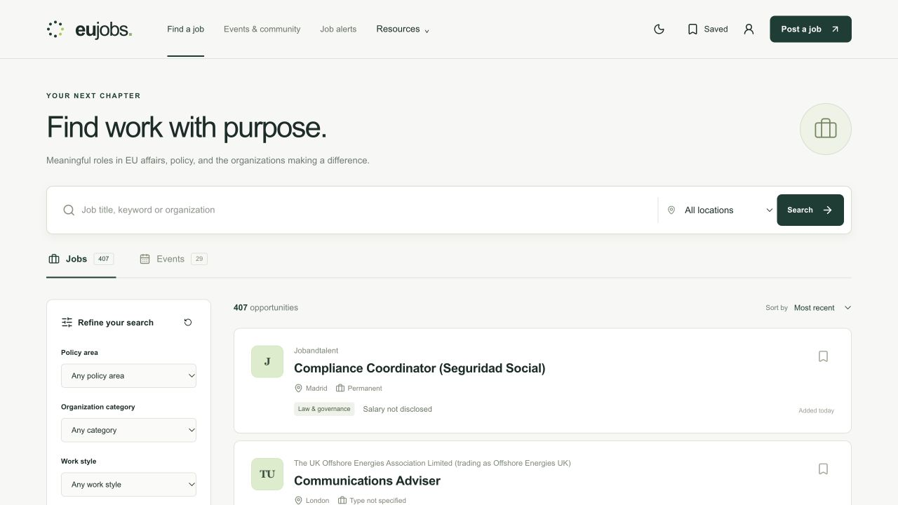

# EUJobs — from product to sale

I built and sold EUJobs, a careers product serving people and organizations working in European affairs. This case study explains the product and the current application's engineering. The sale terms and buyer details are private; the source snapshot describes the implementation verified in October 2026.

## The product problem

European affairs careers sit across institutions, agencies, associations, NGOs, consultancies and international organizations. Finding a relevant role takes more than a keyword search: policy area, location, work style, contract, seniority and salary all affect whether an opportunity is useful. Events and career resources help people participate in the same professional community.

EUJobs brings those journeys into one application: discover a role, understand its source and requirements, save it, follow new matches, and find relevant events.

## A complete commercial workflow

Employers can submit and pay for a listing without first creating an account. The browser creates a scoped management capability so the employer can return to edit the draft, check payment and review status, or renew a posting.

The implementation supports one-time job posting plans and an optional paid monthly event calendar. Payment confirmation grants the purchased entitlement; an editor still controls whether a job is published. Event admission remains separate from calendar access.

The important business distinction is between a payment, permission to publish, actual publication and expiry. The application models those states explicitly instead of treating a successful redirect as a completed transaction.

## Selected engineering decisions

### Make retries safe

Checkout reservations and idempotency keys prevent duplicate sessions. Webhook signatures are verified against the raw body, and order state survives duplicate or out-of-order events. Refund processing is tied to the correct order so an old refund cannot revoke a newer purchase.

### Keep account and guest ownership separate

Entering a contact email does not grant access to an account with the same email. Guest bookkeeping identities are excluded from ordinary login and recovery. Management capabilities are random, hashed at rest, scoped to a single object and exchanged for restricted cookies.

### Preserve editorial control

Changes invalidate approval, and version checks reject stale edits. Imported editorial listings use a separate administrative path. Discovery excludes unpublished or inactive inventory, and unknown fields are displayed honestly.

### Treat email as a durable workflow

Subscription confirmation and unsubscribe flows are explicit. An outbox records work before delivery and handles deduplication, suppression, leases and ambiguous provider responses. A queued message is not reported as delivered.

### Share one public data contract

The public API and remote MCP use the same service and allowlisted schemas. The CLI and local MCP validate responses from that API. These integrations expose job and event discovery without account, payment or application mutations.

## Running the product

The current application runs on an Azure VM with persistent SQLite storage. Release directories separate application code from runtime data and credentials. Systemd runs the app and optional workers; the backup script uses SQLite's online backup API and independently checks the resulting copy.

This design is intentionally suited to a single application instance. Multiple instances would require shared rate limiting and an explicit database/concurrency plan.

## Explore it

Screenshots show public pages captured on 20 October 2026. Inventory and offers change over time; the screenshots are product examples, not adoption or revenue metrics.

[Live product](https://eujobs.co) · [Architecture](ARCHITECTURE.md) · [Source map](REPOSITORY.md) · [Verification and provenance](PROVENANCE.md)
